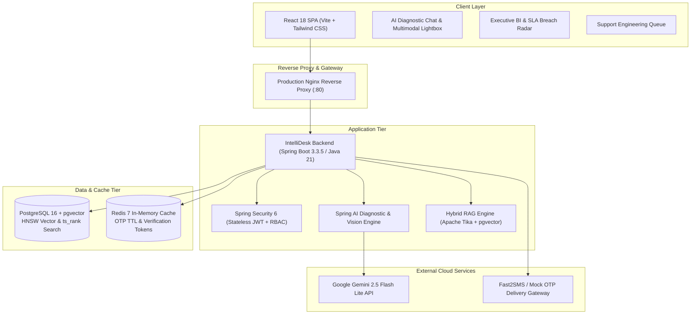

# IntelliDesk — Enterprise AI-Powered IT Support & Autonomous Diagnostic Platform

[](https://openjdk.org/projects/jdk/21/)
[](https://spring.io/projects/spring-boot)
[](https://react.dev/)
[](https://vitejs.dev/)
[](https://github.com/pgvector/pgvector)
[](https://redis.io/)
[](https://deepmind.google/technologies/gemini/)
[](https://www.docker.com/)

---

## 1. Executive Summary & Core Mission

**IntelliDesk** is an enterprise-grade IT Service Management (ITSM) and intelligent troubleshooting platform. It empowers enterprise employees to diagnose and resolve complex technical problems autonomously via multi-turn AI reasoning, multimodal screenshot analysis, and corporate knowledge base retrieval (RAG). 

When self-resolution is not possible, the platform automatically synthesizes the troubleshooting history into structured diagnostic handover packages, triages priority, calculates SLA deadlines, and dispatches the incident to specialized support engineers.

---

## 2. High-Level System Architecture



---

## 3. The 10 Development Phases & Feature Scoreboard

| Phase | Milestone | Key Deliverables | Status |
| :---: | :--- | :--- | :---: |
| **Phase 1** | **Environment & Infrastructure** | Java 21 toolchain, Node 20+, Docker Compose, PostgreSQL 16 with pgvector & Redis. | ✅ Complete |
| **Phase 2** | **Database Schema & JPA Model** | 15 relational tables, HNSW vector indexes, enums, and Spring Data JPA repositories. | ✅ Complete |
| **Phase 3** | **Security & Authentication** | Stateless JWT authentication, BCrypt hashing, strict E.164 phone OTP verification with Redis TTL. | ✅ Complete |
| **Phase 4** | **Ticket Lifecycle Engine** | Ticket state machine (`OPEN` → `ASSIGNED` → `IN_PROGRESS` → `RESOLVED` → `CLOSED`), audit history, and internal comments. | ✅ Complete |
| **Phase 5** | **Frontend SaaS Foundation** | React 18 Single Page App, Cyber Cyan/Electric Violet theme, dark mode persistence, and role guards. | ✅ Complete |
| **Phase 6** | **AI Troubleshooter & Multimodal Vision** | Multi-turn technical reasoning, Gemini 2.5 Flash Lite, clipboard paste (`Ctrl+V`) screenshot diagnostics, and interactive step feedback. | ✅ Complete |
| **Phase 7** | **Knowledge Base & Hybrid RAG** | Ingestion pipeline with Apache Tika parsing (PDF, DOCX, TXT), semantic overlapping chunking, pgvector HNSW search, and citation badges. | ✅ Complete |
| **Phase 8** | **Auto-Triage & Diagnostic Handover** | One-click escalation synthesizing attempted steps, symptom categorization, priority scoring, and SLA target deadlines. | ✅ Complete |
| **Phase 9** | **Executive Analytics & BI Radar** | Real-time deflection rate calculation, mean time to resolution (MTTR), category breakdowns, engineer workload tracking, and SLA breach monitors. | ✅ Complete |
| **Phase 10** | **Production Hardening & Final Handover** | JUnit 5 automated test suite, multi-stage Dockerfiles, production Nginx routing, and operational runbook. | ✅ Complete |

---

## 4. Key Functional Capabilities

### A. Autonomous Multi-Turn AI Diagnostic Assistant
- **Conversational Problem Solving**: Guides users step-by-step through technical procedures (e.g., DNS flushing, VPN certificate updates, display scaling, driver rollbacks).
- **Interactive Step Feedback**: Users can click **"✓ Yes, it worked!"** (triggering confetti celebrations and auto-resolving the session) or request alternate solutions.
- **Multimodal Screenshot Diagnostics**: Employees can paste screenshots directly with `Ctrl + V` or upload error dialogs. Gemini vision examines the image content to identify error codes and misconfigured network dialogs.

### B. Corporate Knowledge Base Ingestion & Hybrid RAG Engine
- **Document Ingestion**: Admins upload standard operating procedures (PDF, Word, Plain text).
- **Apache Tika Parsing**: Extracts metadata, clean text, and formatting.
- **Semantic Chunking**: Breaks text into overlapping contextual chunks and creates vector embeddings stored in PostgreSQL via `pgvector`.
- **Hybrid Retrieval**: Combines cosine similarity with PostgreSQL full-text search (`ts_rank`) for sub-5ms lookup with verified source citations.

### C. Registration & Strict E.164 Phone OTP Verification
- **E.164 Phone Format Validation**: Enforces international telephone standard (e.g. `+919876543210`), hard-caps length to 15 digits, blocks non-digit characters, and provides dynamic character counters.
- **Redis TTL Caching**: OTP codes expire in 5 minutes (`otp:code:{phone}`); verified tokens persist for 15 minutes (`otp:verified:{phone}`) with fallback memory cache.
- **Gateway Flexibility**: Built-in development mode (`devOtp` auto-fill) and production integration ready for Fast2SMS / Twilio.

### D. Executive BI Analytics & SLA Breach Radar
- **AI Deflection Rate**: Tracks percentage of technical issues resolved completely by AI self-service without requiring human engineer intervention.
- **SLA Breach Radar**: Real-time tracking of open tickets approaching SLA deadlines:
  - `CRITICAL`: 2-hour resolution target.
  - `HIGH`: 8-hour resolution target.
  - `MEDIUM`: 24-hour resolution target.
  - `LOW`: 48-hour resolution target.
- **Engineer Workload Balancing**: Real-time distribution charts showing active ticket queues per support engineer.

---

## 5. Default Demo Accounts

The database comes pre-seeded with accounts for all three organizational roles (default password: `Password123!`):

| Role | Email | Password | Department | Primary Responsibilities |
| :--- | :--- | :--- | :--- | :--- |
| **Administrator** | `admin@company.com` | `Password123!` | IT Operations | User directory governance, knowledge ingestion, executive BI, SLA breach radar. |
| **Support Engineer** | `sarah.connor@company.com` | `Password123!` | Infrastructure | Ticket queue triage, ticket resolution, customer comments, diagnostic handover inspection. |
| **Employee** | `alex.morgan@company.com` | `Password123!` | DevOps Engineering | AI troubleshooting assistant, multimodal screenshot analysis, ticket creation, step feedback. |

---

## 6. Quick Start & Production Deployment

### Option A: Complete Docker Compose Production Stack (Recommended)

Run the full four-tier production container stack with a single command:

```bash
docker compose -f docker-compose.prod.yml up --build -d
```

This launches:
1. `intellidesk-postgres-prod`: PostgreSQL 16 with pgvector on port `5433` (mapped from 5432).
2. `intellidesk-redis-prod`: Redis 7 on port `6379`.
3. `intellidesk-backend-prod`: Spring Boot 3 Java 21 container on port `8080`.
4. `intellidesk-frontend-prod`: React 18 Single Page App on port `80` with Nginx reverse proxy.

Access the platform in your browser at:
- **Web Application**: `http://localhost` (or `http://localhost:5173` in local dev)
- **API Documentation / Health**: `http://localhost:8080/actuator/health`

To stop the containers:
```bash
docker compose -f docker-compose.prod.yml down
```

---

### Option B: Local Developer Setup

#### 1. Start Database & Cache
```bash
docker compose up -d
```

#### 2. Start Backend (Spring Boot 3 / Java 21)
```powershell
$env:GEMINI_API_KEY="YOUR_GEMINI_API_KEY"
mvn -f "backend/pom.xml" spring-boot:run
```
The backend initializes on `http://localhost:8080`.

#### 3. Start Frontend (React 18 / Vite)
```bash
cd frontend
npm install
npm run dev
```
The frontend dev server opens on `http://localhost:5173`.

---

## 7. Environment Variables Reference

| Variable | Description | Default / Example |
| :--- | :--- | :--- |
| `SPRING_DATASOURCE_URL` | PostgreSQL JDBC connection string | `jdbc:postgresql://localhost:5433/intellidesk_db` |
| `SPRING_DATASOURCE_USERNAME` | Database username | `postgres` |
| `SPRING_DATASOURCE_PASSWORD` | Database password | `postgrespassword` |
| `SPRING_DATA_REDIS_HOST` | Redis cache hostname | `localhost` (or `redis` in Docker) |
| `SPRING_DATA_REDIS_PORT` | Redis cache port | `6379` |
| `GEMINI_API_KEY` | Google Gemini API key for LLM & vision | `${GEMINI_API_KEY}` |
| `SMS_PROVIDER` | OTP gateway (`mock`, `fast2sms`, `twilio`) | `mock` |
| `FAST2SMS_API_KEY` | Fast2SMS API key (if using live SMS) | Optional |
| `FAST2SMS_OTP_ID` | Fast2SMS Smart OTP Template ID | Optional |
| `INTELLIDESK_APP_JWT_SECRET` | 256-bit secret key for signing JWTs | Secret key string |

---

## 8. REST API Reference Catalog

### Authentication & OTP (`/api/v1/auth`)
- `POST /api/v1/auth/login`: Authenticate email + password, returns JWT token.
- `POST /api/v1/auth/register`: Register new user (requires prior OTP verification).
- `POST /api/v1/auth/otp/send`: Dispatch 6-digit OTP to mobile number.
- `POST /api/v1/auth/otp/verify`: Validate code and issue verified token.
- `GET /api/v1/auth/me`: Get current authenticated user profile.

### AI Troubleshooting & Multimodal Vision (`/api/v1/ai`)
- `POST /api/v1/ai/chat`: Multi-turn conversational troubleshooting (supports text & `imageBase64`).
- `POST /api/v1/ai/steps/feedback`: Submit step resolution feedback (`worked=true/false`).
- `POST /api/v1/ai/escalate`: Auto-create support ticket with AI diagnostic handover package.
- `GET /api/v1/ai/sessions`: Fetch user's recent troubleshooting sessions.
- `GET /api/v1/ai/sessions/{sessionId}`: Fetch chat history and screenshots for session.

### Support Ticket Engine (`/api/v1/tickets`)
- `POST /api/v1/tickets`: Create new support ticket with category and priority.
- `GET /api/v1/tickets`: Page tickets with optional status & priority filters.
- `GET /api/v1/tickets/{id}`: Get full ticket details with SLA and handover summary.
- `PUT /api/v1/tickets/{id}/status`: Transition ticket status (`IN_PROGRESS`, `RESOLVED`, etc.).
- `PUT /api/v1/tickets/{id}/assign`: Assign ticket to support engineer.
- `POST /api/v1/tickets/{id}/comments`: Post internal or customer-facing comment.

### Knowledge Base & RAG (`/api/v1/admin/documents`)
- `POST /api/v1/admin/documents/upload`: Upload SOP document for Apache Tika parsing & vectorization.
- `GET /api/v1/admin/documents`: List ingested knowledge documents with chunk counts.
- `POST /api/v1/admin/documents/test-query`: Test live hybrid RAG retrieval against vectors.

### Executive BI & Analytics (`/api/v1/admin/analytics`)
- `GET /api/v1/admin/analytics`: Return comprehensive KPI telemetry, deflection rate, MTTR, and SLA breach radar.

---

## 9. Automated Testing

The backend includes a comprehensive JUnit 5 and Mockito test suite verifying security, ticket lifecycle, SLA calculation, and AI conversation logic.

Run the tests with:
```bash
mvn -f backend/pom.xml test
```

---

## 10. Repository & Maintainers
- **Repository**: [https://github.com/Santhosh-1102/IntelliDesk.git](https://github.com/Santhosh-1102/IntelliDesk.git)
- **Author**: Santhosh N (`shanthashantha1102@gmail.com`)
- **License**: MIT Enterprise License
